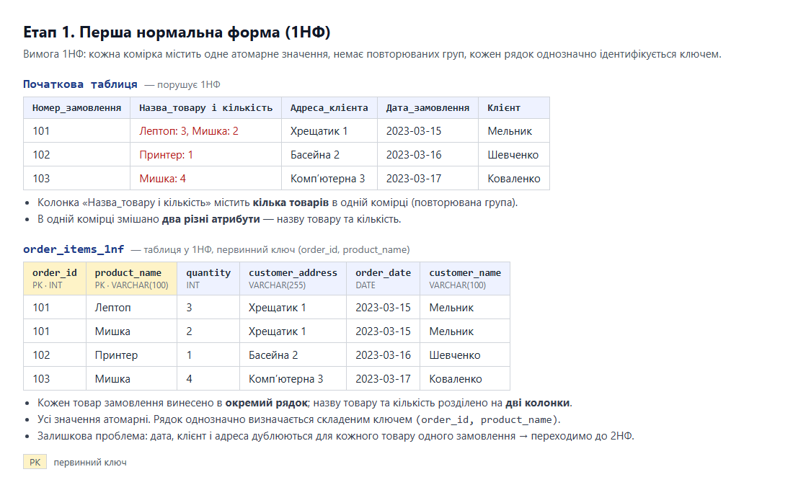
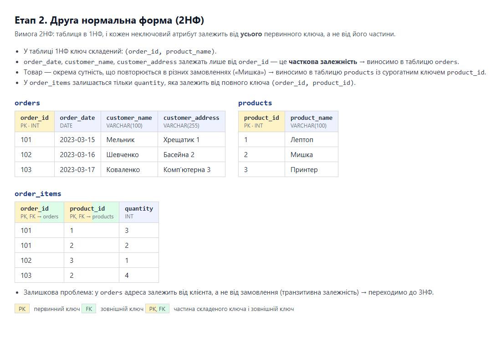
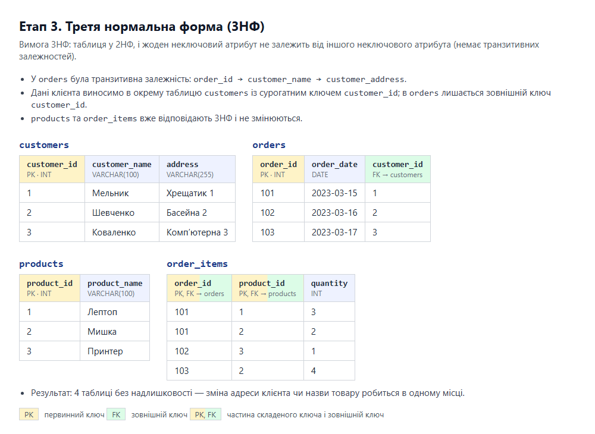
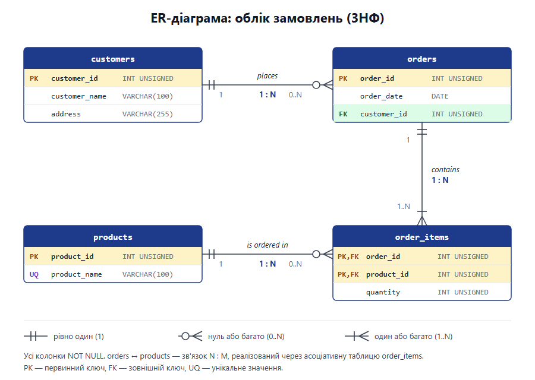
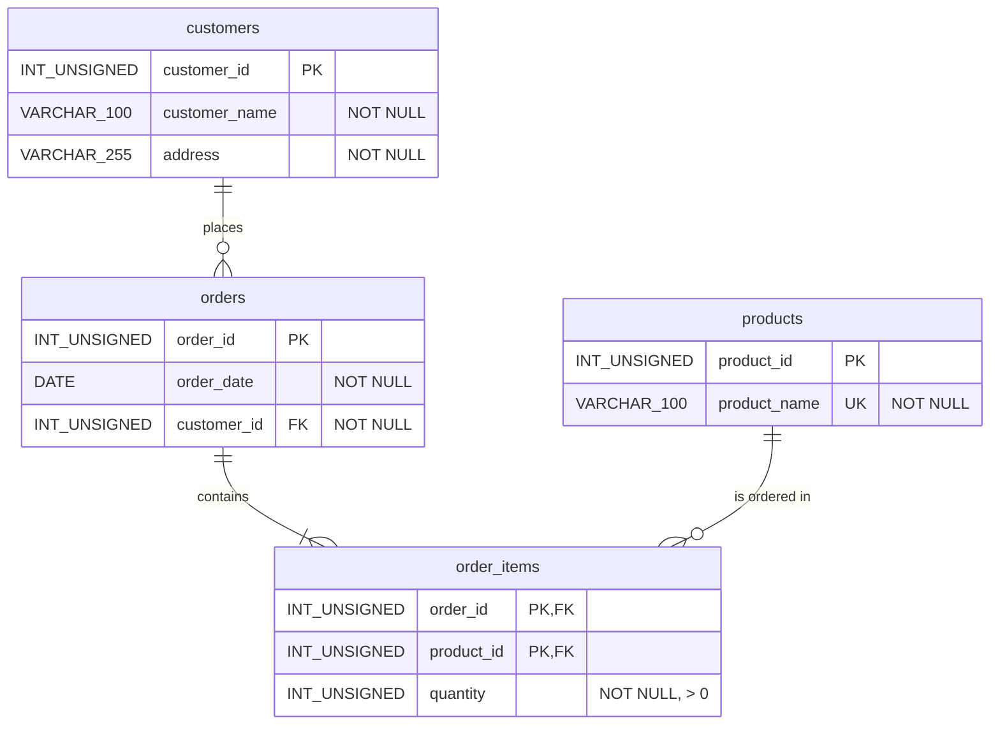

# goit-rdb-hw-02

Домашнє завдання до Теми 2 «Проектування баз даних з використанням семантичних моделей».

## Початкова таблиця

| Номер_замовлення | Назва_товару і кількість | Адреса_клієнта | Дата_замовлення | Клієнт |
|---|---|---|---|---|
| 101 | Лептоп: 3, Мишка: 2 | Хрещатик 1 | 2023-03-15 | Мельник |
| 102 | Принтер: 1 | Басейна 2 | 2023-03-16 | Шевченко |
| 103 | Мишка: 4 | Комп’ютерна 3 | 2023-03-17 | Коваленко |

## Етап 1. Перша нормальна форма (1НФ)

Колонку «Назва_товару і кількість» розбито на дві атомарні колонки `product_name` і `quantity`, а кожен товар замовлення винесено в окремий рядок. Первинний ключ — `(order_id, product_name)`.

## Етап 2. Друга нормальна форма (2НФ)

Атрибути `order_date`, `customer_name`, `customer_address` залежали лише від частини ключа (`order_id`) — їх винесено в таблицю `orders`. Товари винесено в таблицю `products`. У `order_items` лишилася тільки `quantity`, що залежить від повного ключа `(order_id, product_id)`.

## Етап 3. Третя нормальна форма (3НФ)

Транзитивну залежність `order_id → customer_name → customer_address` усунуто: дані клієнта винесено в таблицю `customers`, а в `orders` лишився зовнішній ключ `customer_id`.

## Етап 4. ER-діаграма

Файли: [p4_er_diagram.svg](p4_er_diagram.svg), [p4_er_diagram.png](p4_er_diagram.png).

| Зв'язок | Кардинальність | Опис |
|---|---|---|
| customers → orders | 1 : 0..N | клієнт оформлює нуль або багато замовлень; кожне замовлення належить рівно одному клієнту |
| orders → order_items | 1 : 1..N | замовлення містить щонайменше одну позицію; позиція належить рівно одному замовленню |
| products → order_items | 1 : 0..N | товар може входити в нуль або багато позицій; позиція посилається рівно на один товар |
| orders ↔ products | N : M | реалізовано через асоціативну таблицю `order_items` |

## Етап 5. Таблиці в базі даних

SQL-скрипт для створення схеми `goit_rdb_hw02` (тільки таблиці, колонки та зв'язки, без даних): [p5_schema.sql](p5_schema.sql).

Розгорнута схема у MySQL Workbench:

## Структура репозиторію

| Файл | Етап |
|---|---|
| `p1_1nf.png` | 1 — таблиця у 1НФ |
| `p2_2nf.png` | 2 — таблиці у 2НФ |
| `p3_3nf.png` | 3 — таблиці у 3НФ |
| `p4_er_diagram.svg`, `p4_er_diagram.png` | 4 — ER-діаграма |
| `p5_schema.sql` | 5 — DDL-скрипт створення таблиць |
| `p5_workbench_schema.png` | 5 — скриншот розгорнутої схеми у Workbench |
| `src/` | HTML-джерела, з яких згенеровано скриншоти етапів 1–3 |
