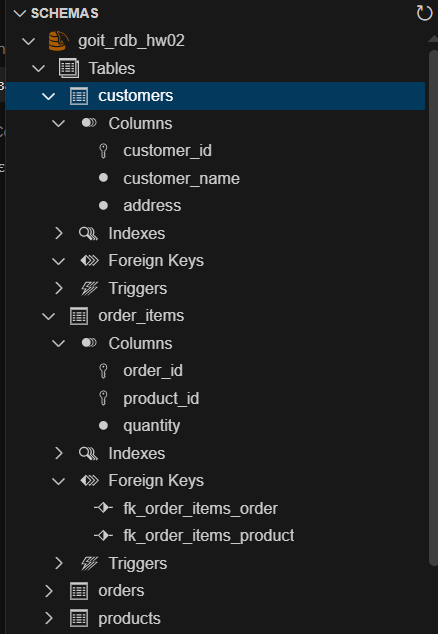
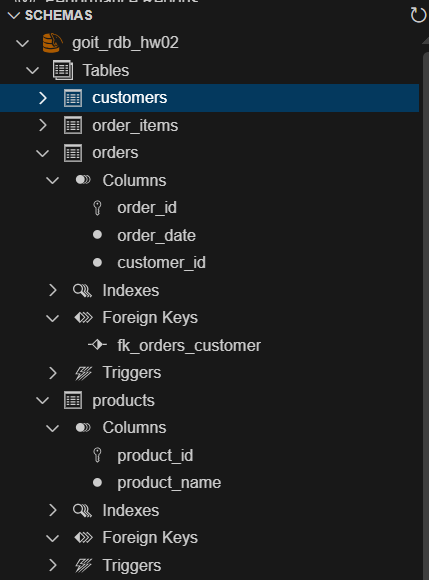

# goit-rdb-hw-02

Домашнє завдання 2 — нормалізація таблиці та ER-діаграма.

## 1. Перша нормальна форма

В колонці "Назва_товару і кількість" було кілька значень в одній клітинці. Розбив її на `product_name` і `quantity`, кожен товар тепер в окремому рядку.

## 2. Друга нормальна форма

Дата, клієнт і адреса залежать тільки від номера замовлення, тому виніс їх в таблицю `orders`. Товари виніс в `products`, а в `order_items` залишилась кількість.

## 3. Третя нормальна форма

Адреса залежить від клієнта, а не від замовлення, тому виніс клієнтів в окрему таблицю `customers`.

## 4. ER-діаграма

- customers — orders: 1 до N
- orders — order_items: 1 до N
- products — order_items: 1 до N (orders і products пов'язані N до M через order_items)

## 5. Таблиці в базі даних

SQL-скрипт: [p5_schema.sql](p5_schema.sql)

